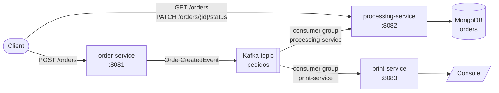

# Order Management System

**English** | [Português (Brasil)](README.pt-BR.md)

Event-driven order management built with Spring Boot microservices.
An order is accepted over REST and published to Kafka. Two independent services then consume it: one stores it in MongoDB, the other prints it to the console.



| Service | Port | Responsibility |
|---|---|---|
| [order-service](order-service/docs/README.md) | 8081 | Receives orders (`POST /orders`), validates them and publishes them to the `pedidos` topic |
| [processing-service](processing-service/docs/README.md) | 8082 | Consumes `pedidos`, stores each order in MongoDB, lists orders and updates their status |
| [print-service](print-service/docs/README.md) | 8083 | Consumes `pedidos` and prints each order to the console |

## Tech stack

- Java 21, Spring Boot 3.5
- Spring for Apache Kafka (producer and consumers)
- Spring Data MongoDB
- Spring Boot Actuator (health, info and metrics)
- Apache Kafka 3.9 in KRaft mode (no ZooKeeper), MongoDB 7, Kafka UI
- Docker Compose for the whole environment
- JUnit 5, Mockito, AssertJ and MockMvc for tests

## Project structure

```
order-management-system/
├── docs/                    # System-wide documentation and diagrams
│   ├── architecture.md
│   ├── requests.http        # Ready-to-run HTTP requests (IntelliJ / VS Code REST Client)
│   └── diagrams/
├── order-service/           # REST API + Kafka producer
│   ├── docs/                # Service documentation and diagrams
│   ├── Dockerfile
│   └── src/
├── processing-service/      # Kafka consumer + MongoDB + query/status API
│   ├── docs/
│   ├── Dockerfile
│   └── src/
├── print-service/           # Kafka consumer that prints orders
│   ├── docs/
│   ├── Dockerfile
│   └── src/
├── docker-compose.yml       # Kafka, MongoDB, Kafka UI and the three services
├── pom.xml                  # Parent Maven project (aggregates the three modules)
└── mvnw / mvnw.cmd          # Maven wrapper, no local Maven install needed
```

Each service is its own Maven module with its own `pom.xml`, `Dockerfile`, configuration and docs. The services share no code: each keeps its own copy of the event it reads, so you can build, deploy and change each one on its own. See [why](docs/architecture.md#design-decisions).

## Running

Requirements: Docker. To run the services outside Docker you also need Java 21.

### Option 1: everything in Docker

```bash
docker compose up -d --build
```

| What | URL |
|---|---|
| order-service | http://localhost:8081 |
| processing-service | http://localhost:8082 |
| print-service | http://localhost:8083 |
| Kafka UI (browse topics and messages) | http://localhost:8090 |
| Kafka (from the host) | `localhost:9092` |
| MongoDB (from the host) | `mongodb://localhost:27017/order_management` |

Follow the receipts printed by the print-service:

```bash
docker compose logs -f print-service
```

Stop everything (add `-v` to also delete the MongoDB data):

```bash
docker compose down
```

### Option 2: infrastructure in Docker, services from the IDE or Maven

```bash
docker compose up -d kafka mongodb kafka-ui
```

Then run each `*Application` class from your IDE, or one service per terminal:

```bash
./mvnw -pl order-service spring-boot:run
```

```bash
./mvnw -pl processing-service spring-boot:run
```

```bash
./mvnw -pl print-service spring-boot:run
```

On Windows use `mvnw.cmd` instead of `./mvnw`.

## Trying the flow

1. Create an order:

```bash
curl -i -X POST http://localhost:8081/orders -H "Content-Type: application/json" -d '{"customerName":"Ana Souza","customerEmail":"ana@example.com","items":[{"productId":"SKU-1","productName":"Mechanical keyboard","quantity":2,"unitPrice":150.00},{"productId":"SKU-2","productName":"Mouse","quantity":1,"unitPrice":79.90}]}'
```

The response is `202 Accepted` with the generated order `id`.

2. See it printed by the print-service (`docker compose logs print-service`).
3. Read it from MongoDB through the processing-service:

```bash
curl http://localhost:8082/orders
```

4. Move it through its lifecycle:

```bash
curl -X PATCH http://localhost:8082/orders/<order-id>/status -H "Content-Type: application/json" -d '{"status":"CONFIRMED"}'
```

[docs/requests.http](docs/requests.http) has every request, including the error cases.

## Observability (Spring Boot Actuator)

Every service exposes these endpoints:

| Endpoint | What it shows |
|---|---|
| `/actuator/health` | Overall status plus details: Kafka connectivity (all services), MongoDB (processing-service), disk space |
| `/actuator/health/liveness`, `/actuator/health/readiness` | Probes used by the Docker health checks |
| `/actuator/info` | Application name, build version and time, Java and OS details |
| `/actuator/metrics` | JVM, HTTP, Kafka client and custom business metrics |

Custom business metrics:

| Service | Metric |
|---|---|
| order-service | `orders.published`, `orders.publish.failures` |
| processing-service | `orders.stored`, `orders.duplicates` |
| print-service | `orders.printed` |

Example: http://localhost:8082/actuator/metrics/orders.stored

## Tests

```bash
./mvnw verify
```

Unit tests cover the business rules, the Kafka publisher's error handling, the order lifecycle, idempotent storage and the receipt format. MockMvc tests cover each REST API, including its error responses. None of them needs Kafka or MongoDB running.

## Exercise checklist

| Requirement | Where |
|---|---|
| `POST /orders` publishing to the `pedidos` topic | [order-service](order-service/docs/README.md) |
| Consumer that stores orders in MongoDB | [processing-service](processing-service/docs/README.md) |
| Second consumer that prints orders to the console | [print-service](print-service/docs/README.md) |
| Actuator enabled in every service | [Observability](#observability-spring-boot-actuator) |
| Custom exceptions (invalid order, Kafka failure, ...) | [Error handling](docs/architecture.md#error-handling) |
| Order listing and status update | [processing-service API](processing-service/docs/README.md#rest-api) |
| SOLID, modular code | [Design decisions](docs/architecture.md#design-decisions) |
| Extra: full Docker setup | [docker-compose.yml](docker-compose.yml) |

## Documentation

- [Architecture](docs/architecture.md): how the services talk to each other, the event contract, error handling and design decisions
- [System diagrams](docs/diagrams/)
- [order-service](order-service/docs/README.md), [processing-service](processing-service/docs/README.md), [print-service](print-service/docs/README.md)
