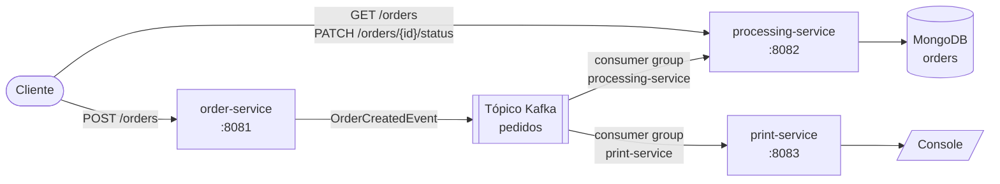

# Sistema de Gerenciamento de Pedidos

[English](README.md) | **Português (Brasil)**

Sistema de gerenciamento de pedidos orientado a eventos, construído com microsserviços Spring Boot.
O pedido é recebido via REST e publicado no Kafka. Em seguida, dois serviços independentes consomem esse pedido: um salva no MongoDB e o outro exibe no console.

> A documentação detalhada (arquitetura, diagramas e a documentação de cada serviço) está em inglês. Este README é a versão em português do ponto de entrada do projeto.



| Serviço | Porta | Responsabilidade |
|---|---|---|
| [order-service](order-service/docs/README.md) | 8081 | Recebe os pedidos (`POST /orders`), valida e publica no tópico `pedidos` |
| [processing-service](processing-service/docs/README.md) | 8082 | Consome o `pedidos`, salva cada pedido no MongoDB, lista os pedidos e atualiza o status |
| [print-service](print-service/docs/README.md) | 8083 | Consome o `pedidos` e exibe cada pedido no console |

## Tecnologias

- Java 21, Spring Boot 3.5
- Spring for Apache Kafka (producer e consumers)
- Spring Data MongoDB
- Spring Boot Actuator (health, info e métricas)
- Apache Kafka 3.9 em modo KRaft (sem ZooKeeper), MongoDB 7, Kafka UI
- Docker Compose para subir o ambiente completo
- JUnit 5, Mockito, AssertJ e MockMvc nos testes

## Estrutura do projeto

```
order-management-system/
├── docs/                    # Documentação e diagramas do sistema como um todo
│   ├── architecture.md
│   ├── requests.http        # Requisições HTTP prontas (IntelliJ / VS Code REST Client)
│   └── diagrams/
├── order-service/           # API REST + producer Kafka
│   ├── docs/                # Documentação e diagramas do serviço
│   ├── Dockerfile
│   └── src/
├── processing-service/      # Consumer Kafka + MongoDB + API de consulta e status
│   ├── docs/
│   ├── Dockerfile
│   └── src/
├── print-service/           # Consumer Kafka que exibe os pedidos
│   ├── docs/
│   ├── Dockerfile
│   └── src/
├── docker-compose.yml       # Kafka, MongoDB, Kafka UI e os três serviços
├── pom.xml                  # Projeto Maven pai (agrega os três módulos)
└── mvnw / mvnw.cmd          # Maven wrapper, não precisa ter o Maven instalado
```

Cada serviço é um módulo Maven próprio, com seu próprio `pom.xml`, `Dockerfile`, configuração e documentação. Os serviços não compartilham código: cada um mantém a própria cópia do evento que lê, então dá para compilar, publicar e alterar cada serviço de forma independente. Veja [o porquê](docs/architecture.md#design-decisions) (em inglês).

## Como executar

Requisitos: Docker. Para rodar os serviços fora do Docker, também é preciso ter o Java 21.

### Opção 1: tudo no Docker

```bash
docker compose up -d --build
```

| O quê | URL |
|---|---|
| order-service | http://localhost:8081 |
| processing-service | http://localhost:8082 |
| print-service | http://localhost:8083 |
| Kafka UI (navegar pelos tópicos e mensagens) | http://localhost:8090 |
| Kafka (acesso pela sua máquina) | `localhost:9092` |
| MongoDB (acesso pela sua máquina) | `mongodb://localhost:27017/order_management` |

Acompanhe os recibos exibidos pelo print-service:

```bash
docker compose logs -f print-service
```

Para parar tudo (adicione `-v` para apagar também os dados do MongoDB):

```bash
docker compose down
```

### Opção 2: infraestrutura no Docker, serviços pela IDE ou pelo Maven

```bash
docker compose up -d kafka mongodb kafka-ui
```

Depois, rode cada classe `*Application` pela IDE, ou um serviço por terminal:

```bash
./mvnw -pl order-service spring-boot:run
```

```bash
./mvnw -pl processing-service spring-boot:run
```

```bash
./mvnw -pl print-service spring-boot:run
```

No Windows, use `mvnw.cmd` no lugar de `./mvnw`.

## Testando o fluxo

1. Crie um pedido:

```bash
curl -i -X POST http://localhost:8081/orders -H "Content-Type: application/json" -d '{"customerName":"Ana Souza","customerEmail":"ana@example.com","items":[{"productId":"SKU-1","productName":"Teclado mecânico","quantity":2,"unitPrice":150.00},{"productId":"SKU-2","productName":"Mouse","quantity":1,"unitPrice":79.90}]}'
```

A resposta é `202 Accepted`, com o `id` gerado para o pedido.

2. Veja o pedido exibido pelo print-service (`docker compose logs print-service`).
3. Consulte o pedido salvo no MongoDB pelo processing-service:

```bash
curl http://localhost:8082/orders
```

4. Avance o pedido no ciclo de vida:

```bash
curl -X PATCH http://localhost:8082/orders/<id-do-pedido>/status -H "Content-Type: application/json" -d '{"status":"CONFIRMED"}'
```

O arquivo [docs/requests.http](docs/requests.http) tem todas as requisições, incluindo os casos de erro.

## Observabilidade (Spring Boot Actuator)

Todos os serviços expõem estes endpoints:

| Endpoint | O que mostra |
|---|---|
| `/actuator/health` | Status geral e detalhes: conexão com o Kafka (todos os serviços), MongoDB (processing-service), espaço em disco |
| `/actuator/health/liveness`, `/actuator/health/readiness` | Probes usadas pelos health checks do Docker |
| `/actuator/info` | Nome da aplicação, versão e horário do build, detalhes do Java e do sistema operacional |
| `/actuator/metrics` | Métricas da JVM, do HTTP, do cliente Kafka e métricas de negócio customizadas |

Métricas de negócio customizadas:

| Serviço | Métrica |
|---|---|
| order-service | `orders.published`, `orders.publish.failures` |
| processing-service | `orders.stored`, `orders.duplicates` |
| print-service | `orders.printed` |

Exemplo: http://localhost:8082/actuator/metrics/orders.stored

## Testes

```bash
./mvnw verify
```

Os testes unitários cobrem as regras de negócio, o tratamento de erros do publisher do Kafka, o ciclo de vida do pedido, o armazenamento idempotente e o formato do recibo. Os testes com MockMvc cobrem cada API REST, incluindo as respostas de erro. Nenhum deles precisa do Kafka ou do MongoDB rodando.

## Checklist do exercício

| Requisito | Onde |
|---|---|
| `POST /orders` publicando no tópico `pedidos` | [order-service](order-service/docs/README.md) |
| Consumer que salva os pedidos no MongoDB | [processing-service](processing-service/docs/README.md) |
| Segundo consumer que exibe os pedidos no console | [print-service](print-service/docs/README.md) |
| Actuator ativo em todos os serviços | [Observabilidade](#observabilidade-spring-boot-actuator) |
| Exceções customizadas (pedido inválido, falha no Kafka, ...) | [Error handling](docs/architecture.md#error-handling) |
| Listagem de pedidos e atualização de status | [API do processing-service](processing-service/docs/README.md#rest-api) |
| SOLID e código modular | [Design decisions](docs/architecture.md#design-decisions) |
| Extra: dockerização completa | [docker-compose.yml](docker-compose.yml) |

## Documentação (em inglês)

- [Arquitetura](docs/architecture.md): como os serviços se comunicam, o contrato do evento, o tratamento de erros e as decisões de design
- [Diagramas do sistema](docs/diagrams/)
- [order-service](order-service/docs/README.md), [processing-service](processing-service/docs/README.md), [print-service](print-service/docs/README.md)
