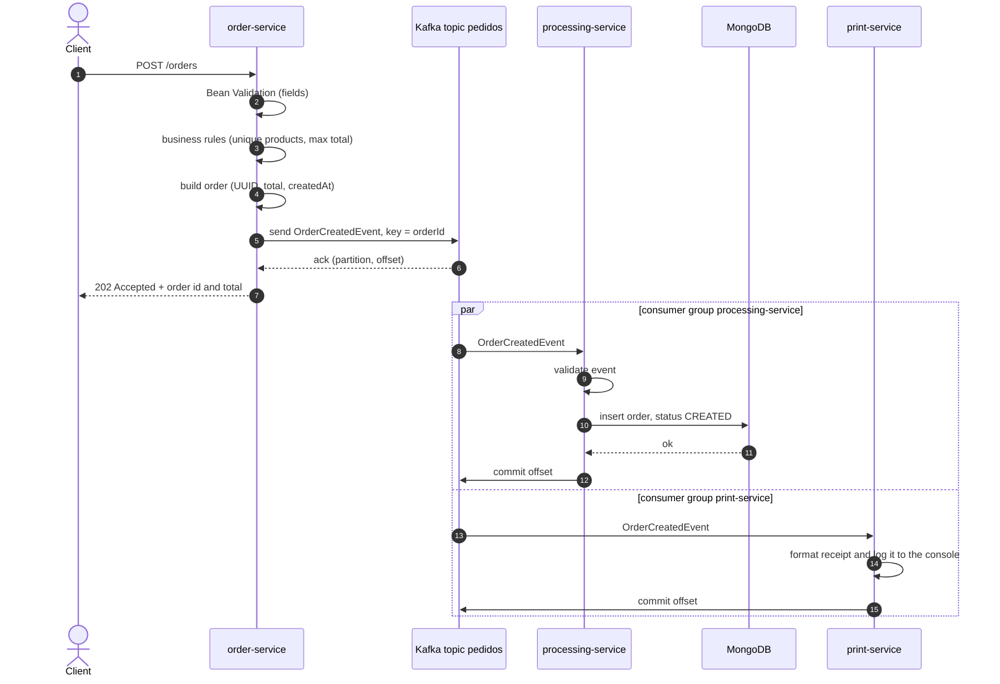
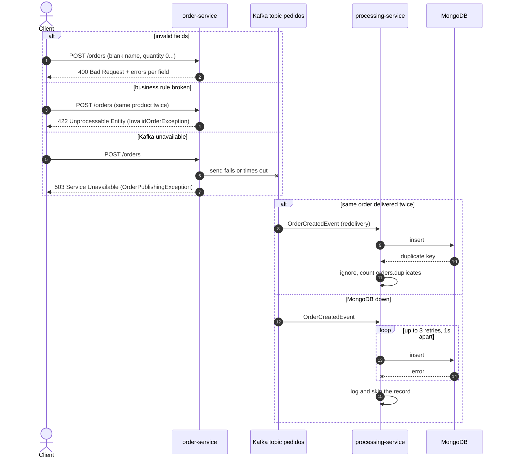

# Create order flow

A new order, from the HTTP request until it is stored and printed.

## When something goes wrong

Order publishing and order storage are decoupled. When the client gets `202`, the order is durably in Kafka. If a consumer is down at that moment, it catches up from its last committed offset when it comes back.
