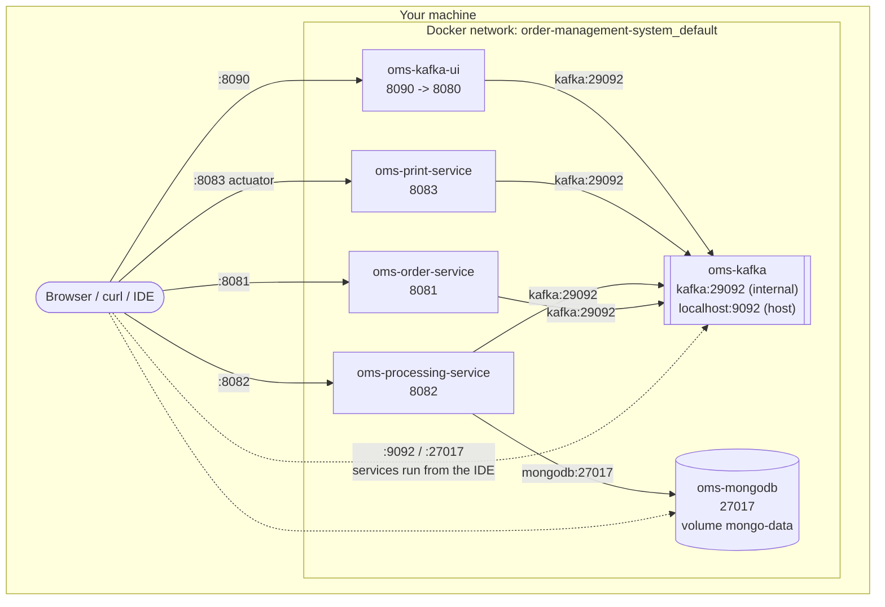

# Deployment (Docker Compose)

`docker compose up -d --build` starts six containers on one Docker network.

## Startup order

Docker health checks control the startup order:

1. `kafka` and `mongodb` start first. Kafka is healthy once its broker API answers. MongoDB is healthy once `ping` succeeds.
2. The services start only after their dependencies are healthy (`depends_on: condition: service_healthy`).
3. Each service is healthy once `/actuator/health/readiness` returns `UP`.

## Kafka listeners

Kafka advertises two addresses:

| Listener | Address | Used by |
|---|---|---|
| `PLAINTEXT` | `kafka:29092` | Containers on the Docker network |
| `PLAINTEXT_HOST` | `localhost:9092` | Applications running on the host (e.g. the IDE) |

The services read the address from the `KAFKA_BOOTSTRAP_SERVERS` environment variable. Its default is `localhost:9092`, and Docker Compose sets it to `kafka:29092`. MongoDB works the same way through `MONGODB_URI`.

## Images

Each service image is built in two stages: Maven builds the jar, then only that jar is copied onto a small Java 21 runtime image (`eclipse-temurin:21-jre-alpine`). The container runs as a non-root user.
