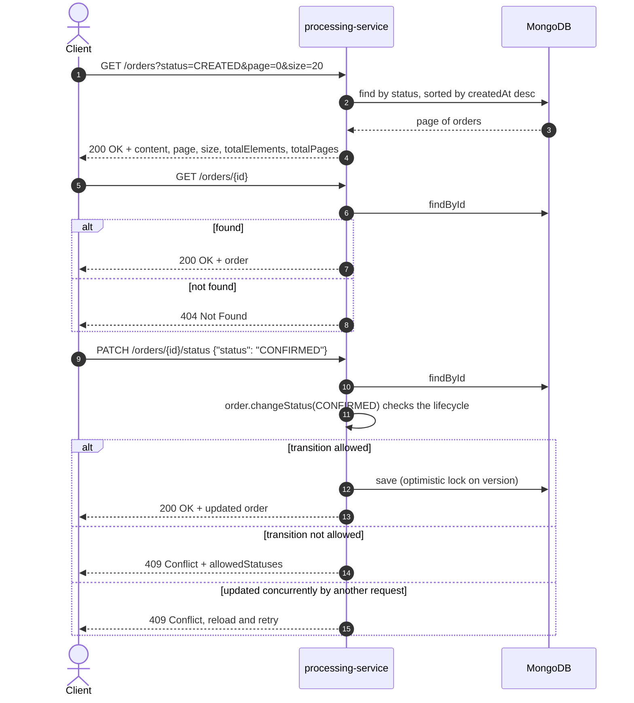

# Query and status update flow

Once stored, orders are read and moved through their lifecycle on the processing-service.

The allowed transitions are in the [order lifecycle diagram](../../processing-service/docs/diagrams/order-lifecycle.md).
