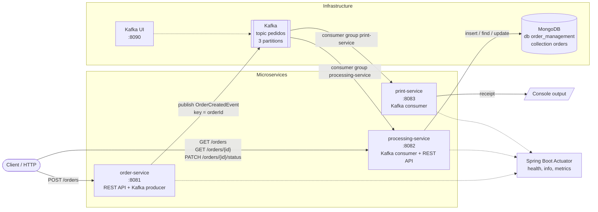

# System overview

All the components and how they connect. Solid arrows are the order flow, dotted arrows are monitoring.

Key points:

- The only link between the services is the `pedidos` topic. No service calls another directly.
- Both consumers get **every** order because they belong to different consumer groups.
- The processing-service owns the MongoDB data, so it also serves the read API.
