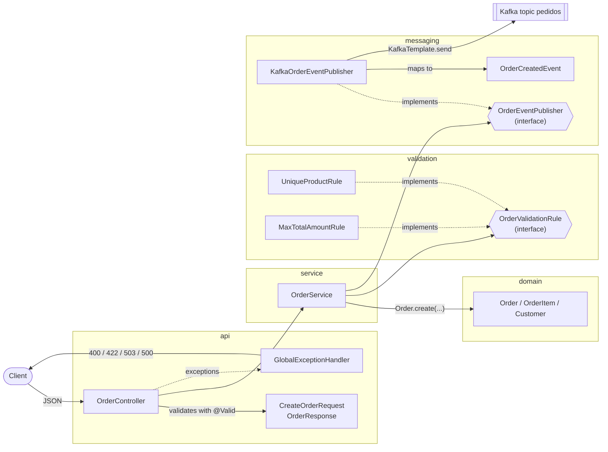

# order-service components

How a `POST /orders` request flows through the classes. The service layer depends only on interfaces (`OrderValidationRule`, `OrderEventPublisher`), so the HTTP and Kafka details stay at the edges.

| Layer | Responsibility | Knows about |
|---|---|---|
| `api` | Turns HTTP into calls and exceptions into HTTP | Spring MVC, DTOs |
| `service` | The "create order" use case | Domain and the two interfaces |
| `validation` | One business rule per class | Domain |
| `messaging` | Turns a domain order into a Kafka message | Kafka, the event contract |
| `domain` | Order data and the total calculation | Nothing else |
