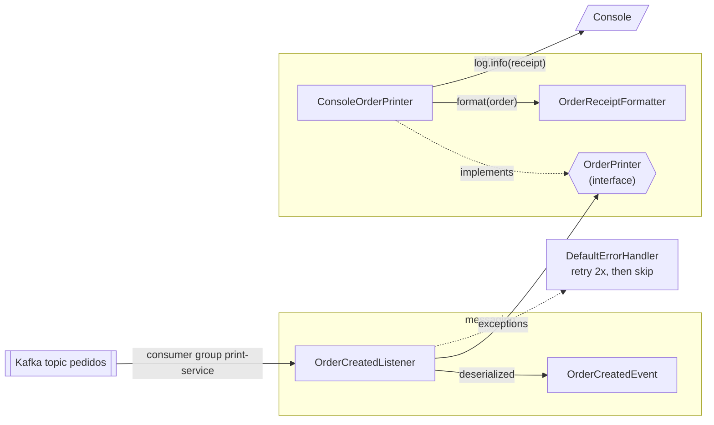

# print-service components

The listener only knows the `OrderPrinter` interface. Printing to a file, to a thermal printer or to a chat channel would need a new implementation, and the Kafka side wouldn't change. Formatting is a separate class, so it can be unit-tested without capturing console output.
