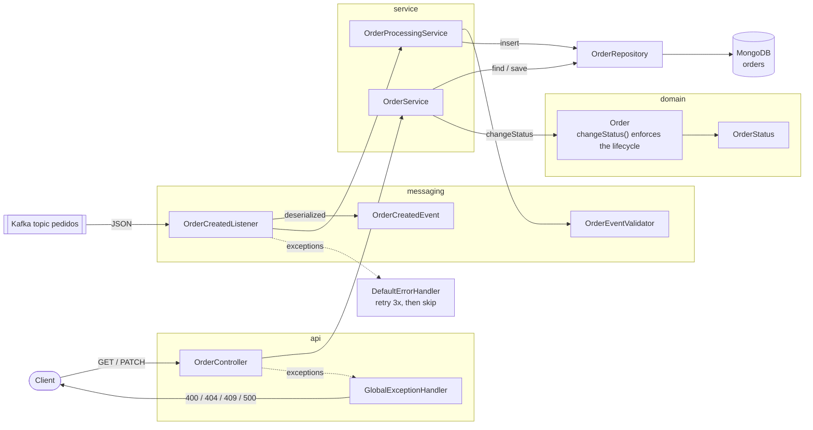

# processing-service components

The service has two entry points. The **Kafka listener** writes new orders, and the **REST controller** reads them and changes their status. Each entry point has its own service class, and both use the same repository.

| Class | Responsibility |
|---|---|
| `OrderCreatedListener` | Receives Kafka records and hands them to the service |
| `OrderProcessingService` | Validates an event and stores it, ignoring duplicates |
| `OrderService` | Lists orders, finds one, changes its status |
| `Order` | Holds the data and refuses status changes the lifecycle doesn't allow |
| `OrderRepository` | MongoDB access (Spring Data) |
| `DefaultErrorHandler` | Retries transient failures and skips messages that can never be processed |
