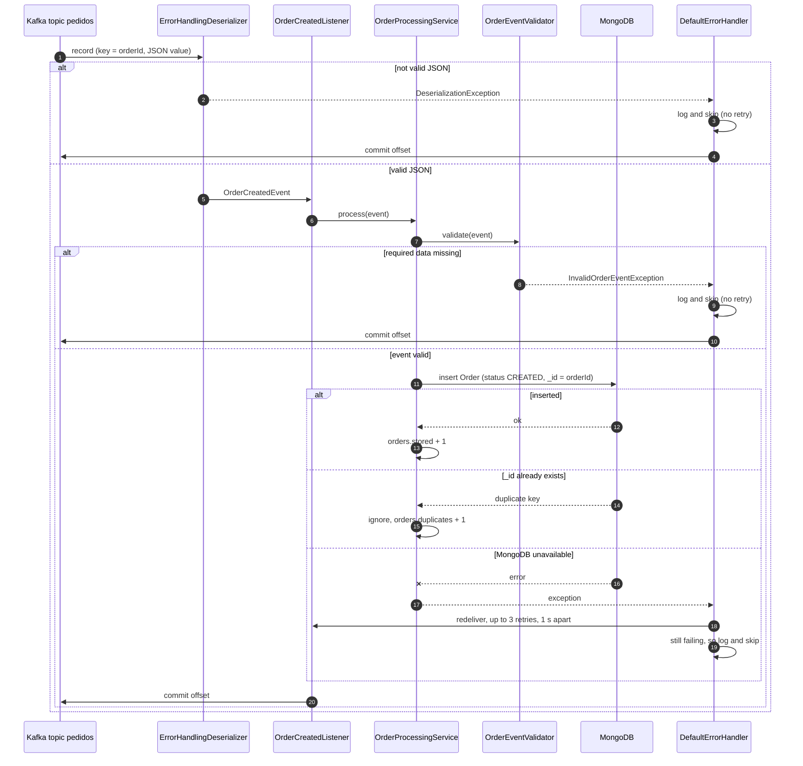

# Consume order sequence (processing-service)

The offset is committed only after a record is handled (stored, ignored as duplicate, or skipped). If the service crashes halfway, Kafka redelivers the record on restart, and the duplicate check keeps that redelivery harmless.
