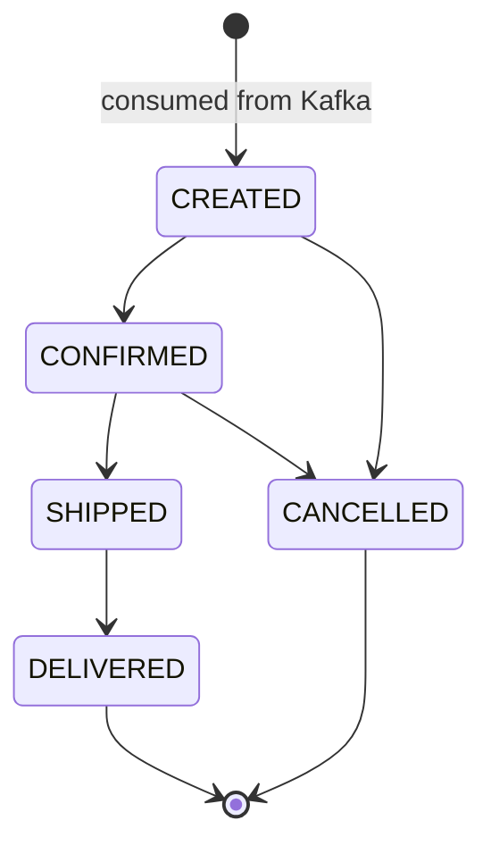

# Order lifecycle

Every order enters as `CREATED` when it is consumed from Kafka. Its status then changes through `PATCH /orders/{id}/status`. `OrderStatus.canTransitionTo` defines the allowed moves, and `Order.changeStatus` enforces them. Any other change returns `409 Conflict` with the allowed statuses.

| Current status | Can move to |
|---|---|
| `CREATED` | `CONFIRMED`, `CANCELLED` |
| `CONFIRMED` | `SHIPPED`, `CANCELLED` |
| `SHIPPED` | `DELIVERED` |
| `DELIVERED` | (final) |
| `CANCELLED` | (final) |

Once shipped, an order can no longer be cancelled.
